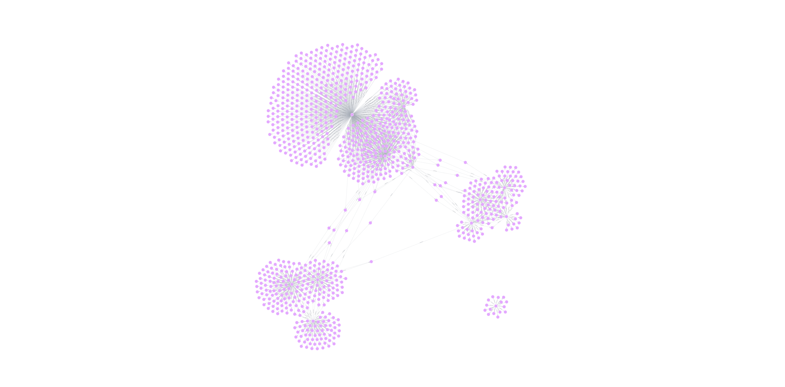
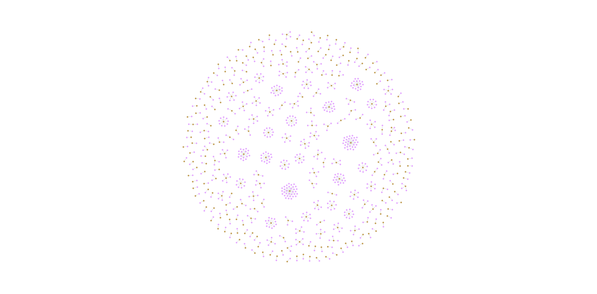
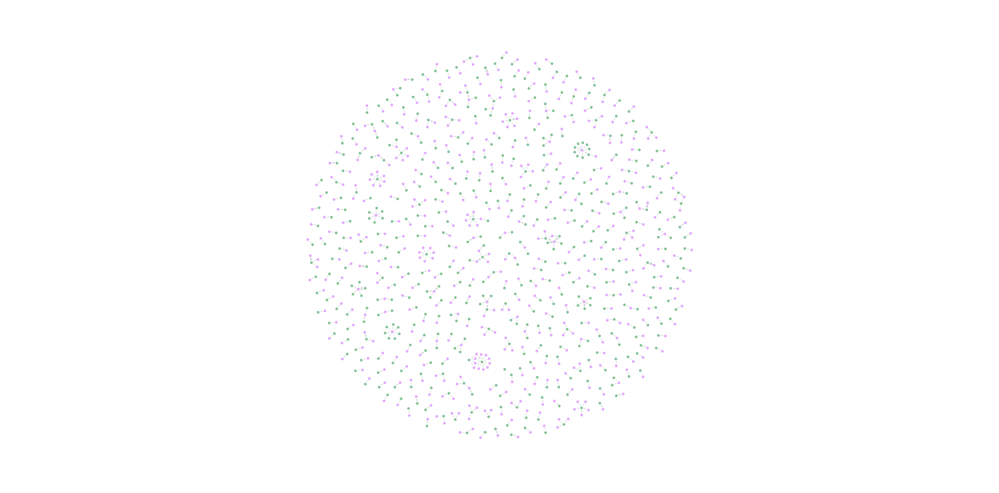

# Session-Based Recommendation System

graph-based recommendation system that uses co-occurrence patterns to predict the next item a user might be interested in. The system achieves an MRR (Mean Reciprocal Rank) of **0.2503** on the test dataset.

## Structure

The system follows this structure:

### Project Structure
```
session-based-recommendation/
├── src/                          # Core application modules
│   ├── app.py                   # Main Flask application
│   ├── utils.py                 # Database utilities
│   ├── graph_loader.py          # Data pipeline & graph construction
│   ├── recommender_engine.py    # Core recommendation logic
│   └── llm_service.py           # LLM integration
├── templates/                    # Jinja2 HTML templates
│   ├── base.html               # Base template with navigation
│   ├── index.html              # Dashboard
│   ├── prediction.html         # Recommendation results
│   ├── explanation.html        # LLM explanations
│   ├── patterns.html           # Pattern analysis
│   ├── graph.html              # Real-time graph visualization
│   ├── prompt.html             # LLM prompt interface
│   └── session_demo.html       # Interactive session demo
├── static/                      # Static assets
│   ├── css/
│   │   └── main.css            # Custom styles
│   └── js/
│       └── main.js             # JavaScript utilities
├── data/                        # Dataset files
│   ├── events.csv              # User interaction events
│   ├── item_properties_part1.csv & part2.csv
│   └── category_tree.csv       # Product categories
└── requirements.txt            # Python dependencies
```

### data link `https://www.kaggle.com/datasets/retailrocket/ecommerce-dataset/data`

### 🖼️ Schema & Session Flow

Below are visual aids stored in the `schema_images/` folder to help understand the graph schema and sessionization flow.


*Figure 1 — Graph schema: nodes (Product, Session) and key relationships (IN_SESSION, CO_OCCURS_WITH).*


*Figure 2 — Sessionization and recommendation pipeline: raw events → sessions → co-occurrence graph → next-item prediction.*


*Figure 3 — Belonging_to query relationship*


*Figure 3 — performed  query relationship*

## Quick Start

### Prerequisites

1. **Neo4j Database** - Version 5+ with proper memory configuration
2. **Python Dependencies** - Install from `requirements.txt`
3. **Data Files** - Ensure all CSV files are in the above link directory

### Installation

```bash
pip install -r requirements.txt
```

### Neo4j Setup

Ensure your Neo4j instance is running with the following configuration:
- Memory settings: `dbms.memory.transaction.total.max` and `server.memory.heap.max_size` configured

### Running the System

#### Option 1: Quick Test (if data is already loaded)
```bash
python test_modularization.py
```

#### Option 2: Full System Setup
```bash
python setup_system.py
```

#### Flask Demo Application
```bash
python src/app.py
```
Then visit `http://localhost:5000` in your browser.

## System Components

### 1. Data Pipeline (`graph_loader.py`)

- **`preprocess_data()`** - Loads and processes CSV files, implements sessionization logic
- **`create_schema()`** - Creates Neo4j constraints and indexes
- **`load_all_data()`** - Loads all nodes and relationships to Neo4j
- **`create_co_occurrence_relationships()`** - Creates the core recommendation relationships

### 2. Recommendation Engine (`recommender_engine.py`)

- **`get_next_item_prediction()`** - Returns top K recommendations for a given product
- **`find_recurring_patterns()`** - Identifies frequent sequential patterns
- **`calculate_mrr()`** - Evaluates system performance using Mean Reciprocal Rank
- **`generate_llm_prompt()`** - Creates contextual explanations for recommendations

### 3. Web Interface (`app.py`)

- **`/`** - Main dashboard showing MRR score
- **`/predict/<pid>`** - Get recommendations for a specific product
- **`/patterns`** - View top recurring patterns
- **`/api/mrr`** - API endpoint to calculate MRR (demo)

## Key Results

### Performance Metrics
- **MRR Score**: 0.2503
- **Total Sessions**: 1,930,778
- **Total Products**: 235,061
- **CO_OCCURS_WITH Relationships**: 1,153,137

### Example Recommendations
For Product 119736:
1. PID: 186702 (Popularity: 94, Avg Time: 157s)
2. PID: 417927 (Popularity: 47, Avg Time: 143s)
3. PID: 190000 (Popularity: 37, Avg Time: 217s)

### Top Patterns
1. 40870 → 40870 → 40870 (Count: 224)
2. 461686 → 461686 → 461686 (Count: 148)
3. 414432 → 414432 → 414432 (Count: 98)

## Algorithm Details

The system implements a co-occurrence-based approach:

1. **Sessionization**: Groups user events into sessions using a 5-minute timeout
2. **Graph Construction**: Creates a graph with products, sessions, and co-occurrence relationships
3. **Recommendation**: Uses co-occurrence popularity to rank potential next items
4. **Evaluation**: Measures performance using MRR on a 10% test set

### Calculate MRR
```python
from src.recommender_engine import calculate_mrr
import pandas as pd

events_df = pd.read_csv('data/events.csv')
# ... preprocess events_df ...
mrr_score = calculate_mrr(driver, events_df)
```

## Notes

- All product IDs and property values are hashed/anonymous
- The system assumes Neo4j memory configuration is properly set
- MRR calculation can take several minutes due to the large dataset
- The Flask app provides a simple web interface for demonstration

## Troubleshooting

1. **Connection Issues**: Verify Neo4j is running and credentials are correct
2. **Memory Errors**: Ensure Neo4j has sufficient memory allocated
3. **Slow Performance**: The system is designed for accuracy over speed
4. **Missing Data**: Ensure all CSV files are present in the `data/` directory
